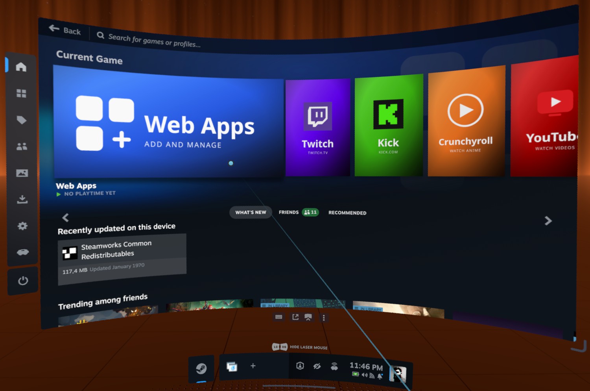
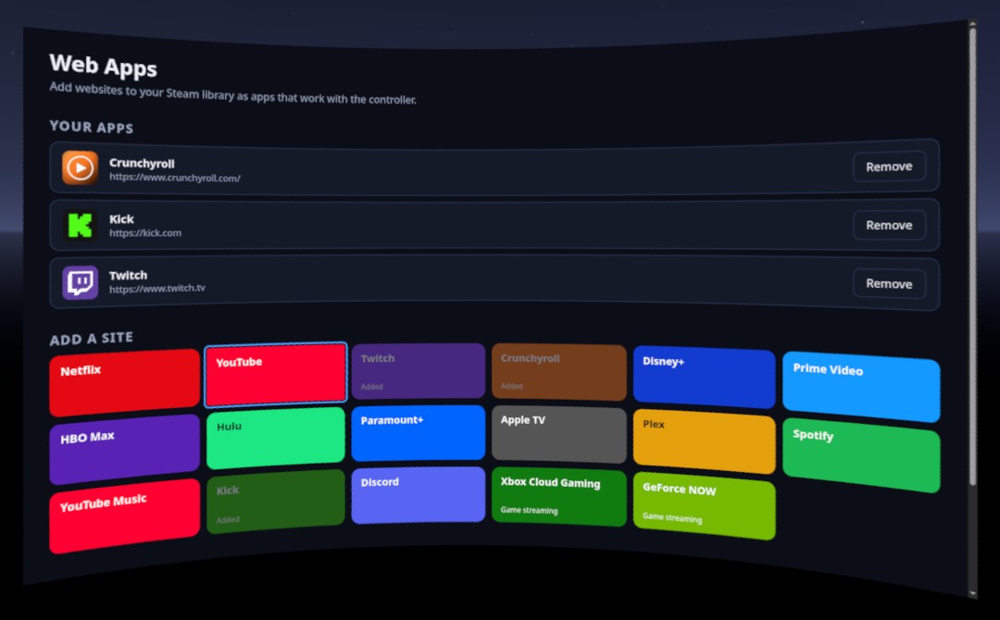
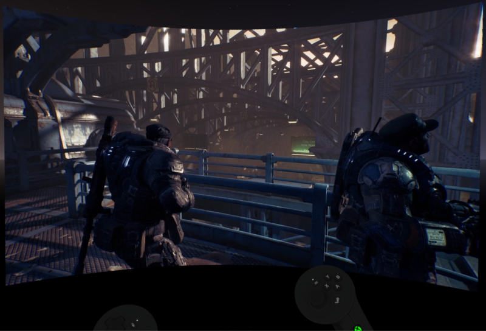

# frame-webapps


**Turn any website into an app on your Steam Frame, with full controller support.**



```bash
frame-webapp add "Netflix" https://www.netflix.com
```

One command, or one press in the **Web Apps** manager, puts the site in your Steam library. Then you open it like any game:

🎮 **The controller works.** Sticks scroll, the D-pad moves between links, A clicks, X plays and pauses.  
🎬 **Streaming video plays.** Apps run in Chromium with Widevine DRM.  
🖼️ **It looks like it belongs.** Artwork and icon are made from the site's own icon and colour.  
🔐 **You stay signed in.** Each app has its own browser profile, separate from your normal browser.  
🧹 **It's easy to undo.** No password, nothing system-wide, and one command removes an app.  

Made for streaming sites, but you can add any site. Built and tested on a Steam Frame running SteamOS 0.5.10,
SteamVR 2.19.4 and Flathub Chromium 158 (November 2026). Tried in the headset so far: Crunchyroll, Twitch, Kick and Xbox Cloud Gaming.
If a site misbehaves, please open an issue with its address.

## Install

On the Frame, in Desktop Mode, open Konsole and run:

```bash
curl -fsSL https://raw.githubusercontent.com/breferrari/frame-webapps/main/install.sh | bash
```

No password, nothing system-wide, nothing restarts. See [what it changes](#what-installsh-changes).
To update later, run the same line again.

### From a PC, without Konsole (experimental)

[FramePort](https://github.com/spoopyghosty0/frameport) installs apps on a Frame from a PC. In FramePort, choose
"Install from link…" and paste:

```
https://raw.githubusercontent.com/breferrari/frame-webapps/main/frameport.json
```

It downloads the release archive, copies it to the Frame and adds **Web Apps** to your Steam library. The first time
you open Web Apps it finishes the setup by itself. Chromium must be on the Frame
(`flatpak install flathub org.chromium.Chromium`).

This route is new: the archive passes FramePort's own checks, but nobody has run it end to end yet. If it fails for
you, please [open an issue](https://github.com/breferrari/frame-webapps/issues).

## Use

### The Web Apps manager

After installing, **Web Apps** is in your Steam library (and in the desktop menu). Open it in the headset and use the
controller:



- **Add a site** from the grid of known sites with one press, or type just an address under **Another site**
  (the name is taken from the site).
- **Remove** an app with two presses. It leaves the Steam library at once. If the app is open, it is closed first.
- **Extensions** adds extras such as an ad blocker to one app. Press it, then "Open the store": a browser window opens
  on the Chrome Web Store. Find what you want and choose "Add to Chrome" with the laser pointer (tap grip). When you
  are done, close the tab (the small X on the tab at the top) to come back. The next time you open the app, the
  extension is there. It stays with that app only.
- Artwork and icons appear right away. Nothing ever restarts.

### The command

| | |
|---|---|
| Add an app | `frame-webapp add "Name" https://site.example` (the name is optional) |
| Game streaming site | add `--controller native`: the site gets the controller directly (see below) |
| TV interface | add `--controller tv` with the TV address, e.g. `https://www.youtube.com/tv` (see below) |
| List | `frame-webapp list` |
| New artwork | `frame-webapp art "Name" [--icon file.png] [--color "#e50914"]` |
| Extensions | `frame-webapp extensions "Name"` opens the Chrome Web Store for that app, for an ad blocker and the like |
| Remove | `frame-webapp remove "Name"` (add `--keep-data` to keep the sign-in) |
| Update the tool | `frame-webapp update` |

Then **open the app from the Steam library**. Two things to know:

- **No restart needed.** The app, its artwork and its icon show up in the library right away, and removing an app takes
  it out of the library at once. Steam has to be running.
- **Don't launch it from the multitasking "+" menu.** That menu starts desktop apps, which get the laser pointer only.

### Controls

| Controller | Action |
|---|---|
| Sticks | Smooth scroll |
| D-pad | Move focus between links and buttons (in a video player: ←/→ seek 10 s, ↑/↓ volume) |
| A / B / X / Y | Click / back / play-pause / fullscreen |
| LB / RB | −10 s / +10 s |
| LT / RT | Previous/next-episode or skip-intro button if the site has one, else −30 s / +30 s |
| Laser pointer | Still works: tap **grip** to switch between laser and gamepad mode |

### Different artwork

The artwork is generated from the site's own icon and colour. To change it:

- `frame-webapp art "Name" --icon my-image.png --color "#e50914"` uses your own image and colour.
- For community-made cover art, use [SteamGridDB](https://www.steamgriddb.com) and its own tools. They can set artwork
  on any entry in your Steam library, including the ones added here.

**Game streaming sites** (Xbox Cloud Gaming, GeForce NOW and the like) read the controller themselves. Add them with
`--controller native`, or from the manager's grid, where they are marked "Game streaming". They then get the
controller directly, and the navigation above is off for that app.



**TV interfaces.** Some sites have an interface made for TVs and remote controls, which suits a controller better
than their desktop site. YouTube's is `https://www.youtube.com/tv`: the manager's grid has it as "YouTube TV", next to
the regular YouTube. With `--controller tv` the app presents itself as a TV and the controller acts as the remote: D-pad or
stick to move, A = OK, B = back, X = play/pause, LB/RB = rewind/forward.

## Limits

- **Site quirks.** Scrolling, focus and video controls are generic and act on the page directly. Sites with unusual
  players or menus may need tweaks.
- **Video quality** is whatever the site gives Linux browsers (often 720p for DRM services).
- **Icons.** Some sites block automated requests, so the tool can't fetch their icon and draws a plain tile.
  Pass your own with `--icon`.
- Made for the Steam Frame. Untested on other SteamOS devices.

## How it works

Open a streaming site as a Chromium "web app" from the Steam library and the Frame's controllers barely work: no stick
scrolling, no buttons. Steam can't link a **Flatpak** window to its shortcut, so whatever a Steam Input layout sends
(keys, mouse wheel) never reaches the page, and Steam Input can't be turned off for the Frame's controllers.

frame-webapps **reads the controller inside the page** instead:

1. A new shortcut gets Steam's gamepad layout, so Steam feeds a virtual Xbox pad.
2. Flatpak Chromium is allowed to see it (`--filesystem=/run/udev:ro`: its gamepad backend needs the udev database).
3. A small extension, [`frame-gamepad`](webapps/extensions/frame-gamepad), polls the Gamepad API and scrolls, moves
   focus, clicks and controls the `<video>`.

It runs in Flathub Chromium, so **Widevine DRM** keeps working and DRM sites play. Chromium only downloads Widevine
after a profile's first start, so the tool puts it into each new app's profile beforehand; on a Frame that has no
copy yet, the installer fetches one in the background (about a minute), so it is normally there before you open
your first app. Each app gets its own browser
profile, so apps run side by side and stay signed in separately from your normal Chromium.

[docs/web-apps.md](docs/web-apps.md) has the details: how it works, troubleshooting, and the approaches that did
*not* work (and why).

## What install.sh changes

Everything lives in your home folder:

| Path | What |
|---|---|
| `~/.local/share/frame-webapps/` | The tool, your apps (`apps/`), icons and logs |
| `~/.local/bin/frame-webapp` | The command (a link) |
| One line in `~/.bashrc` | Adds `~/.local/bin` to the command search path, if it isn't there already |
| `~/.local/share/applications/frame-webapps-manager.desktop` | The "Web Apps" menu entry |
| A "Web Apps" entry in your Steam library | The manager. It serves its page on this device only (`127.0.0.1`) while it is open |
| `~/.config/systemd/user/frame-webapps-chromium-lock.service` | At session start, clears a stale Chromium profile lock left by a restart |

Each app also gets a Chromium profile in `~/.var/app/org.chromium.Chromium/config/webapp-<Name>WebApp/` and a
`frame-webapp-<name>.desktop` entry (for its window icon).

**Uninstall:** remove your apps with `frame-webapp remove`, remove "Web Apps" from the Steam library
(Manage > Remove non-Steam game), then:

```bash
systemctl --user disable frame-webapps-chromium-lock.service
rm -rf ~/.local/share/frame-webapps ~/.local/bin/frame-webapp \
       ~/.local/share/applications/frame-webapps-manager.desktop \
       ~/.config/systemd/user/frame-webapps-chromium-lock.service
```

You can also delete the line marked "added by frame-webapps" from `~/.bashrc`.

## What's inside

| Path | What |
|---|---|
| `bin/frame-webapp` | The command: add, list, art, remove, manager, setup, update |
| `manager/` | The Web Apps manager: its page, the catalogue of known sites, and its Steam launcher |
| `webapps/_chromium-webapp.sh` | Launcher: Chromium app mode, one profile per app, Widevine, stale-lock fix, udev access, extension, logs |
| `webapps/extensions/frame-gamepad-tv/` | The TV-mode extension: turns the controller into remote-control keys |
| `webapps/extensions/frame-gamepad/` | The controller extension (MV3 content script, no permissions, no network) |
| `webapps/launch-via-steam.sh` | Starts a shortcut *through* Steam from a `.desktop` file |
| `scripts/steamcef.py` | Talks to the running Steam through its local interface: add and remove shortcuts, set artwork and icons, no restart |
| `scripts/steam-shortcuts.py` | Lists the non-Steam shortcuts (reads the binary `shortcuts.vdf`) |
| `scripts/steam-art.py` | Renders library artwork (cover, wide, hero, logo, icon) with `rsvg-convert` |
| `launcher/web-apps.c`, `scripts/make-release.sh`, `frameport.json` | The release archive: a tiny compiled starter for the manager, the build script, and the manifest FramePort reads |
| `scripts/widevine.sh` | Gives each new app's profile the Widevine DRM component before its first start |
| `scripts/chromium-stale-lock-cleanup.sh`, `systemd/` | Clears a stale Chromium profile lock at session start |

Not affiliated with Valve or any of the sites you add. Use at your own risk.

## Credits

- [coah80/frametube](https://github.com/coah80/frametube) (MIT), a YouTube TV app for the Frame, inspired the in-page gamepad approach
- [coah80/steam-frame-gamepad-mode](https://github.com/coah80/steam-frame-gamepad-mode) and
  [lostpanda85/frame-docs](https://github.com/lostpanda85/frame-docs): community notes on Frame input

## License

MIT, see [LICENSE](LICENSE).
